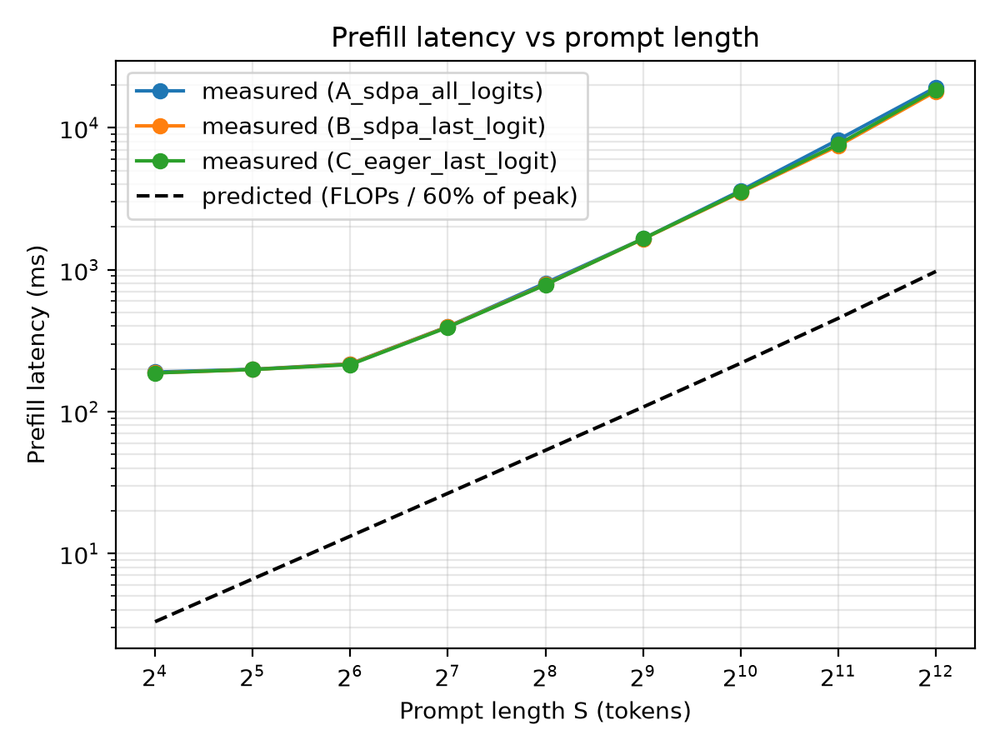
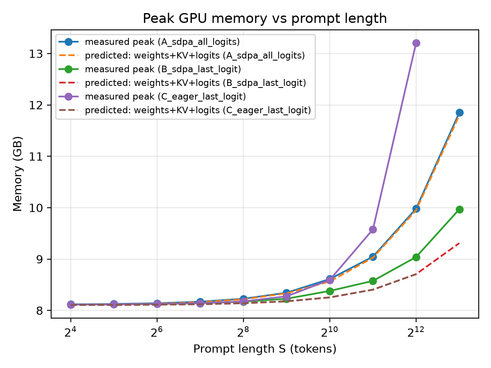
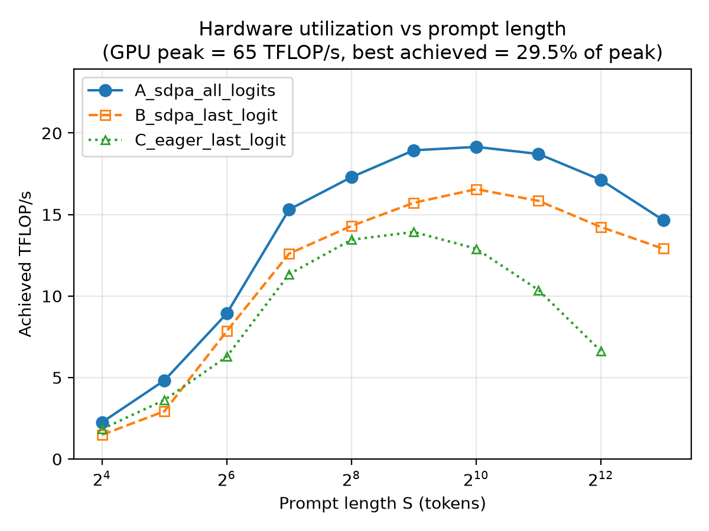
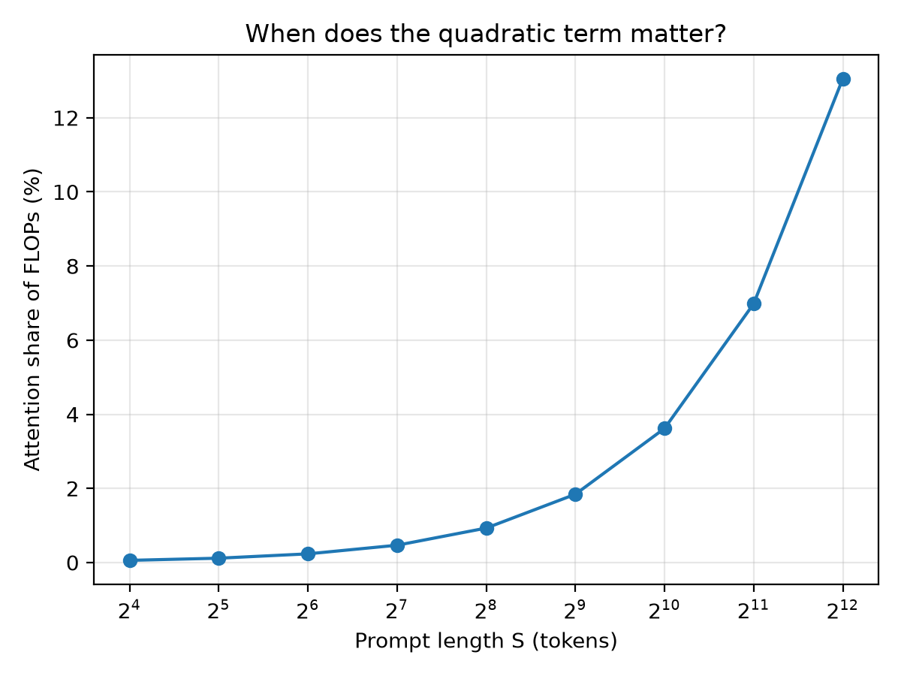

# Qwen3-4B Prefill Context Scaling

[](https://colab.research.google.com/github/KingPleather/BSE_Context_Qwen_Benchmark/blob/main/prefill_benchmark.ipynb)


[](https://huggingface.co/Qwen/Qwen3-4B)

Measuring how prefill latency and GPU memory grow with prompt length in Qwen3-4B, and how well first-principles FLOP and memory models predict that growth.

<p align="center">
  
</p>

## Key findings

- **Short prompts are overhead-bound.** From 16 to 64 tokens, latency barely moves (187 to 217 ms). Streaming 8 GB of weights and launching kernels costs more than the actual math.
- **Long prompts scale superlinearly.** Going from 128 to 4096 tokens (32x) increases latency about 46x, as the quadratic attention term grows from 0.5% to 14% of total FLOPs.
- **The memory model holds until activations take over.** Weights + KV cache + logits predicts peak memory within 0.15 GB up to 512 tokens. At 4096 tokens, transient activations add about 5.3 GB the model doesn't account for, and 8192 tokens runs out of memory on a 15 GB T4.
- **Full-sequence logits are wasted work in prefill.** Keeping only the last position's logits saves about 1.2 s at 4096 tokens.
- **Hardware matters as much as the model.** The T4 lacks native bfloat16, so throughput topped out near 2.6 TFLOP/s (about 4% of peak), leaving measured latency well above the compute-bound prediction.

## Research question

> How closely do prefill latency and memory follow theoretical FLOP and memory predictions as prompt length increases?

## Setup

| | |
|---|---|
| Model | [`Qwen/Qwen3-4B`](https://huggingface.co/Qwen/Qwen3-4B), 4.02B parameters |
| Precision | bfloat16 |
| GPU | NVIDIA Tesla T4, 15 GB (Google Colab) |
| Software | PyTorch 2.14.1 (CUDA 13.0), Transformers 5.22.2, Python 3.13.16 |
| Batch size | 1 |
| Timing | CUDA events, 2 warmup runs, median of 5 timed runs |
| Prompt lengths | 16 to 8192 tokens (powers of 2), random token IDs, seed 0 |

### Architecture

| Layers | Hidden size | Query heads | KV heads (GQA) | Head dim | FFN size (SwiGLU) | Vocab |
|---|---|---|---|---|---|---|
| 36 | 2560 | 32 | 8 | 128 | 9728 | 151,936 |

Grouped-query attention shares each KV head across 4 query heads, which shrinks the KV cache to 147,456 bytes per token (4x smaller than standard multi-head attention).

## Method

### Theoretical model

For a prefill of `S` tokens:

```
FLOPs_linear    = 2 · S · P_layers                  (P_layers ≈ 3.63B, linear in S)
FLOPs_attention = 2 · L · n_q · d_h · S²            (causal, quadratic in S)
FLOPs_lm_head   = 2 · n_logits · V · D

Memory          = weights + S · 2 · L · n_kv · d_h · 2 bytes + n_logits · V · 2 bytes
                  (8.10 GB)   (KV cache)                      (logits)
```

Predicted latency assumes a compute-bound pass at 60% of the GPU's peak dense throughput.

### Experiments

| ID | Attention | Logits | What it isolates |
|---|---|---|---|
| A | SDPA | all positions | Hugging Face default behavior |
| B | SDPA | last position | removes the `S × V` logits tensor |
| C | eager | last position | materializes the full `S × S` attention matrix |

## Results

| S | A (ms) | B (ms) | C (ms) | Peak mem, B (GB) | Predicted, B (GB) | Attention FLOPs |
|---:|---:|---:|---:|---:|---:|---:|
| 16 | 189.7 | 187.1 | 187.0 | 8.11 | 8.10 | 0.1% |
| 128 | 397.1 | 395.8 | 392.9 | 8.15 | 8.12 | 0.5% |
| 512 | 1,652.2 | 1,645.4 | 1,650.5 | 8.31 | 8.18 | 2.0% |
| 1024 | 3,606.7 | 3,502.7 | 3,536.8 | 8.69 | 8.25 | 4.0% |
| 2048 | 8,241.3 | 7,464.9 | 7,647.5 | 9.84 | 8.40 | 7.7% |
| 4096 | 19,279.2 | 18,065.9 | 18,524.4 | 14.01 | 8.71 | 14.3% |
| 8192 | OOM | OOM | not run | | | |

Run-to-run variation stayed at or below 1.1% (std / median) across every configuration. Full raw data with min, median, and std for each point is in [`prefill_results/results/`](prefill_results/results/), alongside metadata files recording the exact environment of each run.

<table>
  <tr>
    <td></td>
    <td></td>
  </tr>
  <tr>
    <td align="center">Peak GPU memory vs prompt length</td>
    <td align="center">Achieved throughput vs prompt length</td>
  </tr>
  <tr>
    <td></td>
    <td></td>
  </tr>
  <tr>
    <td align="center">Attention share of total FLOPs</td>
    <td align="center">Prefill latency vs prompt length</td>
  </tr>
</table>

## Reproducing

### Colab

Open the notebook with the badge at the top, select a GPU runtime, and run all cells. It installs dependencies, runs all three experiments, renders the figures, and packages the results as a zip.

### Local

Requires a CUDA GPU with at least 16 GB of memory for the full sweep.

```bash
git clone https://github.com/KingPleather/BSE_Context_Qwen_Benchmark.git
cd BSE_Context_Qwen_Benchmark/prefill_results
pip install torch transformers accelerate pandas matplotlib

python benchmark_prefill.py --lengths 16,32,64,128,256,512,1024,2048,4096,8192 \
    --out results/A_sdpa_all_logits.csv
python benchmark_prefill.py --lengths 16,32,64,128,256,512,1024,2048,4096,8192 \
    --logits-to-keep 1 --out results/B_sdpa_last_logit.csv
python benchmark_prefill.py --attn eager --lengths 16,32,64,128,256,512,1024,2048,4096 \
    --logits-to-keep 1 --out results/C_eager_last_logit.csv

python plot_results.py results/A_sdpa_all_logits.csv results/B_sdpa_last_logit.csv \
    results/C_eager_last_logit.csv --peak-tflops 65
```

`--peak-tflops` should match your GPU's dense FP16/BF16 peak (T4: 65, L4: 121, A100: 312, H100: 989). Other options: `--trials`, `--warmup`, `--dtype {auto,bf16,fp16}`, `--seed`. Sweeps stop cleanly at the first out-of-memory length.

## Project structure

```
.
├── prefill_benchmark.ipynb       end-to-end Colab notebook
└── prefill_results/
    ├── benchmark_prefill.py      latency and memory sweep with FLOP/memory predictions
    ├── plot_results.py           figure generation
    ├── results/                  raw CSVs and per-run environment metadata
    └── figures/                  generated plots
```

## Limitations

- Results come from a single T4 running emulated bfloat16, so absolute latencies understate what native bf16 hardware (L4, A100, H100) would achieve.
- Only batch size 1 is measured.
- The memory model omits transient activations and underestimates peak usage at long contexts.
- FlashAttention 2 is not supported on the T4's Turing architecture and was not tested.

## Authors

Srikar Papineni and Jonathan Tan

## References

- Qwen Team. [*Qwen3 Technical Report*](https://arxiv.org/abs/2505.09388), 2025.
- [Qwen3-4B model card](https://huggingface.co/Qwen/Qwen3-4B), Hugging Face.
